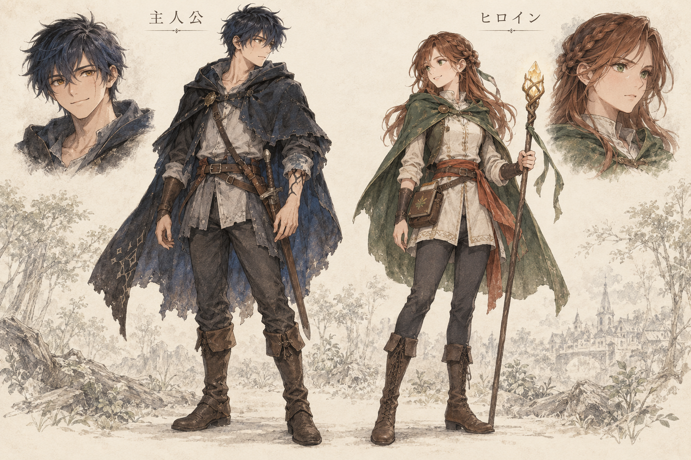

# ストーリー

物語、キャラクター、クエスト、会話等のナラティブ情報を管理します。

- [ストーリー骨格](./overview.md)

## キャラクターのコンセプトアート

人間社会で冒険する時期の主人公とヒロインを描いた初期デザイン案です。

文書の配置規則は [ドキュメント規約](../development/documentation-rules.md)、ゲーム全体の中核コンセプトは [ゲームビジョン](../game/vision.md) を参照してください。
